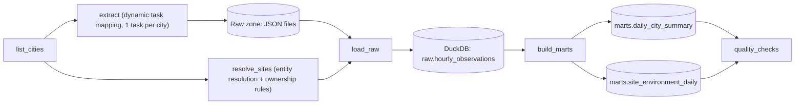

# Weather & Air Quality ELT with Apache Airflow


A production-style batch pipeline built on **Apache Airflow 2.10**. Every day it pulls hourly weather
and air-quality data for six cities from the free [Open-Meteo](https://open-meteo.com) APIs, lands the
raw JSON, loads it into **DuckDB**, and builds analytics marts. It also resolves messy site-inventory
records to canonical cities (**entity resolution**) and assigns owners from version-controlled rules.
The run fails if data quality checks don't pass.

**Cost: $0.** No cloud account, no API keys. Runs locally in Docker.

## Architecture




## Quickstart

Requires Docker with Compose.

```bash
git clone https://github.com/sohailalij/airflow-weather-elt.git
cd airflow-weather-elt
make up          # builds image, starts Airflow at http://localhost:8080 (admin / admin)
make trigger     # run the DAG now (or wait for the daily schedule)
make query       # print the latest results from DuckDB
```

On Windows without `make`, run the underlying commands directly:

```powershell
docker compose up -d --build
docker compose exec airflow-scheduler airflow dags trigger weather_air_quality_elt
docker compose exec airflow-scheduler python /opt/airflow/scripts/query.py
```

Backfill a week of history (the forecast API serves roughly the last 92 days):

```bash
docker compose exec airflow-scheduler \
  airflow dags backfill -s 2026-10-01 -e 2026-10-07 weather_air_quality_elt
```

## Engineering decisions

| Decision | Why |
|---|---|
| **Dynamic task mapping** for extraction | Adding a city is a one-line config change; each city retries independently. |
| **Idempotent loads** (delete-and-insert for the day inside one transaction) | Any task can be re-run or backfilled without duplicates. |
| **Atomic raw writes** (temp file + rename) | A crashed task never leaves a half-written file. |
| **Single load task** instead of mapped loads | DuckDB permits one writer at a time. Parallelism where it helps (HTTP), serialization where it matters (writes). |
| **Business logic outside the DAG file** (`include/weather_pipeline/`) | Plain Python that is unit-testable without Airflow and keeps DAG parsing fast. |
| **Quality gate with `retries=0`** | Bad data is not a transient failure. It should fail fast and loudly. |
| **`max_active_tis_per_dag=3`**, exponential backoff retries | Respects the free API and absorbs transient failures. |
| **DAG integrity tests + CI** | Import errors and broken dependencies get caught before merge. |
| **Entity resolution with confidence scores** | Every match records its method and score, and ambiguous or low-confidence records are flagged instead of guessed. |
| **Ownership rules in YAML** | Attribution logic is reviewable, diffable and testable like any other code. |
| **`resolve_sites` runs in parallel with `extract` but before `load_raw`** | Extraction never touches DuckDB, but two writers cannot overlap, so both writers are sequenced. |

## Data quality checks

Per city, per day: row count is 24, no duplicate timestamps, temperature null ratio is at most 5%,
temperature within -90 to 60 °C, AQI within 0 to 500, and every expected city is present in the mart.

Attribution layer: the run fails if the site resolution rate drops below 80%, if any site has no owner,
or if `marts.site_environment_daily` does not match the number of resolved sites.

## Entity resolution and ownership attribution

Real asset inventories are messy. `resolve_sites` takes a site inventory whose location strings look like
`Phoenix, AZ`, `PHX`, `Londn`, `São Paulo`, `Delhi NCR`, resolves each one to a canonical city, and assigns an
owner, business unit and criticality tier. The result is joined to the daily weather and air-quality data, so
environmental risk can be reported per owner and tier (`marts.site_environment_daily`).

How a record is matched, in order:

1. **Exact** match after normalization (lowercase, accents and punctuation removed, `, AZ` and `- BR` suffixes dropped).
2. **Alias** match from `city_aliases.yaml` (`PHX` to Phoenix, `Tokio` to Tokyo).
3. **Fuzzy** match with [RapidFuzz](https://github.com/rapidfuzz/RapidFuzz) (token-set similarity, threshold 85).
   A runner-up within 5 points marks the record **ambiguous** (for example `Tokyo London Joint Lab`),
   and anything below the threshold stays **unresolved** (`Atlantis Lab`). Unsafe matches are flagged, never guessed.

Every record keeps its `match_method`, `match_score` and `status`, so each decision can be audited.

**Ownership rules are code.** `ownership_rules.yaml` assigns business unit, owner team and tier from site type and
cost center. Rules run top to bottom, the first rule to set a field wins, and defaults fill the rest. The rules
are version-controlled, so every change goes through review.

> The inventory in `include/weather_pipeline/reference/site_inventory.csv` is synthetic sample data, with two
> deliberately unresolvable rows to show the flagging behavior.

## Data notes

- A run for today's date includes forecast hours for the rest of the day. Past days contain observed or reanalysis data.
- Open-Meteo's forecast endpoint serves roughly the last 92 days, which limits how far back a backfill can go.

## Project layout

```
dags/                                           Airflow DAG definition (orchestration only)
include/weather_pipeline/                       extract / transform / warehouse logic (pure Python)
include/weather_pipeline/entity_resolution.py   fuzzy matching + ownership rules engine
include/weather_pipeline/reference/             site inventory CSV, city aliases, ownership rules (YAML)
tests/                                          unit tests + DAG integrity tests
scripts/query.py                                quick results viewer
docs/                                           screenshots
.github/workflows/ci.yml                        lint + tests on every push
docker-compose.yml                              Airflow + Postgres, LocalExecutor
```

## Testing

```bash
pip install -r requirements-dev.txt
pip install "apache-airflow==2.10.5" \
  --constraint https://raw.githubusercontent.com/apache/airflow/constraints-2.10.5/constraints-3.12.txt
make test
```

Without Airflow installed, the DAG integrity tests are skipped and the rest still run. CI runs everything,
including the DAG tests, on every push.

## Possible extensions

- Swap DuckDB for Postgres or MotherDuck's free tier and add a mapped load.
- Add dbt-duckdb for the mart layer.
- Add a Streamlit dashboard reading `marts.daily_city_summary` and `marts.site_environment_daily`.
- Replace `notify_failure` logging with a Slack webhook.

## License

MIT
