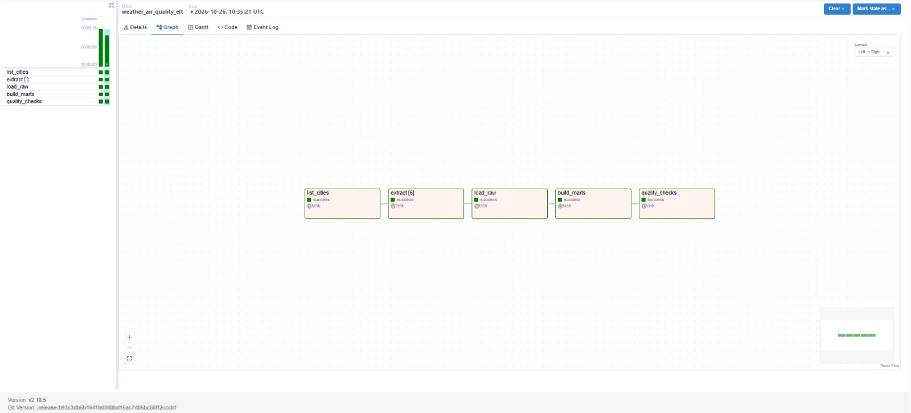
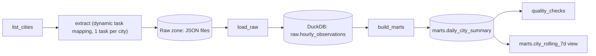

# Weather & Air Quality ELT with Apache Airflow


A production-style batch pipeline built on **Apache Airflow 2.10**. Every day it pulls hourly weather
and air-quality data for six cities from the free [Open-Meteo](https://open-meteo.com) APIs, lands the
raw JSON, loads it into **DuckDB**, builds an analytics mart, and fails the run if data quality checks don't pass.

**Cost: $0.** No cloud account, no API keys. Runs locally in Docker.

## Architecture





## Quickstart

Requires Docker with Compose.

```bash
git clone https://github.com/YOUR_USERNAME/airflow-weather-elt.git
cd airflow-weather-elt
make up          # builds image, starts Airflow at http://localhost:8080 (admin / admin)
make trigger     # run the DAG now (or wait for the daily schedule)
make query       # print the latest results from DuckDB
```

Backfill a week of history (the forecast API serves roughly the last 92 days):

```bash
docker compose exec airflow-scheduler \
  airflow dags backfill -s 2026-10-01 -e 2026-10-07 weather_air_quality_elt
```

## Engineering decisions

| Decision | Why |
|---|---|
| **Dynamic task mapping** for extraction | Adding a city is a one-line config change; each city retries independently. |
| **Idempotent loads** (delete-and-insert for the day inside one transaction) | Any task can be re-run or backfilled without duplicates. |
| **Atomic raw writes** (temp file + rename) | A crashed task never leaves a half-written file. |
| **Single load task** instead of mapped loads | DuckDB permits one writer at a time. Parallelism where it helps (HTTP), serialization where it matters (writes). |
| **Business logic outside the DAG file** (`include/weather_pipeline/`) | Plain Python that is unit-testable without Airflow and keeps DAG parsing fast. |
| **Quality gate with `retries=0`** | Bad data is not a transient failure. It should fail fast and loudly. |
| **`max_active_tis_per_dag=3`**, exponential backoff retries | Respects the free API and absorbs transient failures. |
| **DAG integrity tests + CI** | Import errors and broken dependencies get caught before merge. |

## Data quality checks

Per city, per day: row count is 24, no duplicate timestamps, temperature null ratio is at most 5%,
temperature within -90 to 60 °C, AQI within 0 to 500, and every expected city is present in the mart.

## Project layout

```
dags/                      Airflow DAG definition (orchestration only)
include/weather_pipeline/  extract / transform / warehouse logic (pure Python)
tests/                     unit tests + DAG integrity tests
scripts/query.py           quick results viewer
.github/workflows/ci.yml   lint + tests on every push
docker-compose.yml         Airflow + Postgres, LocalExecutor
```

## Testing

```bash
pip install -r requirements-dev.txt
pip install "apache-airflow==2.10.5" \
  --constraint https://raw.githubusercontent.com/apache/airflow/constraints-2.10.5/constraints-3.12.txt
make test
```

Without Airflow installed, the DAG integrity tests are skipped and the rest still run.

## Possible extensions

- Swap DuckDB for Postgres or MotherDuck's free tier and add a mapped load.
- Add dbt-duckdb for the mart layer.
- Add a Streamlit dashboard reading `marts.daily_city_summary`.
- Replace `notify_failure` logging with a Slack webhook.

## License

MIT
